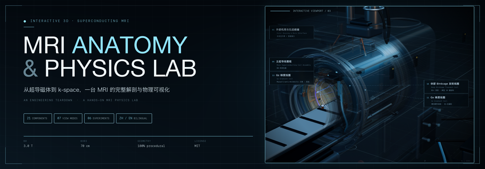
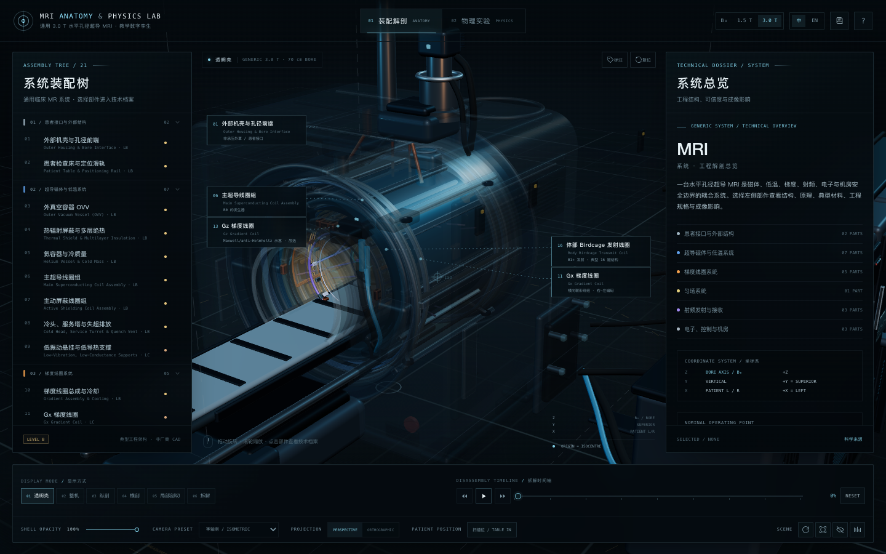
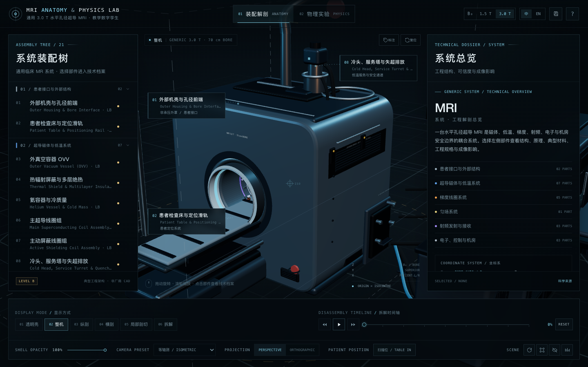
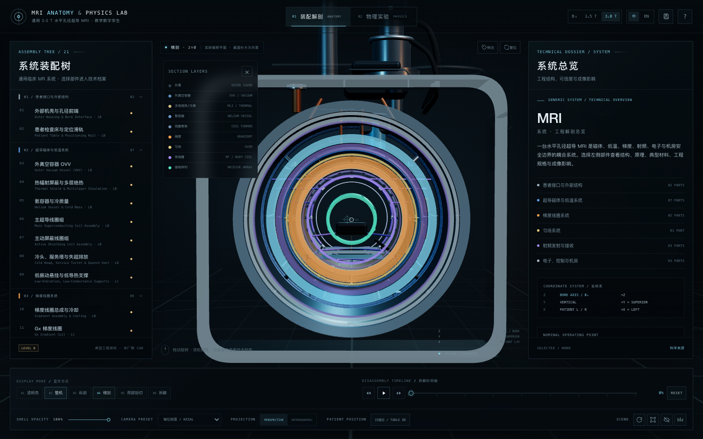
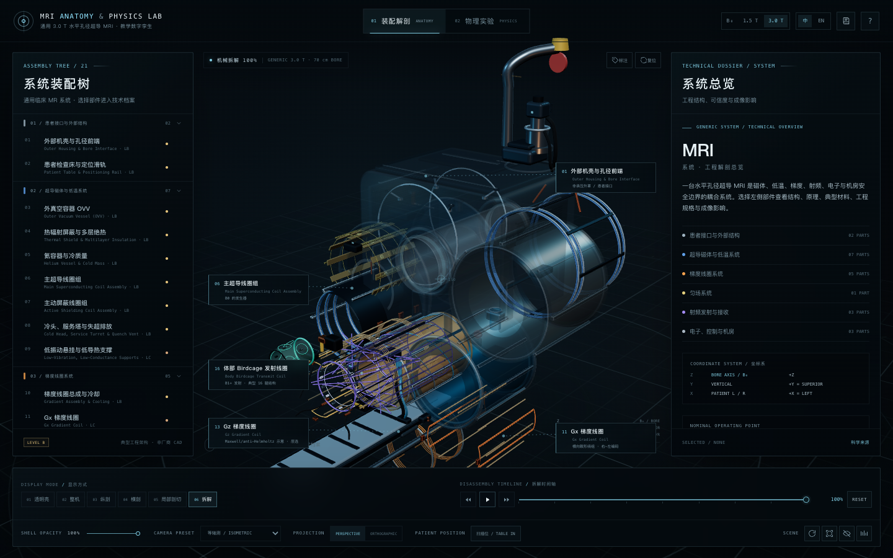
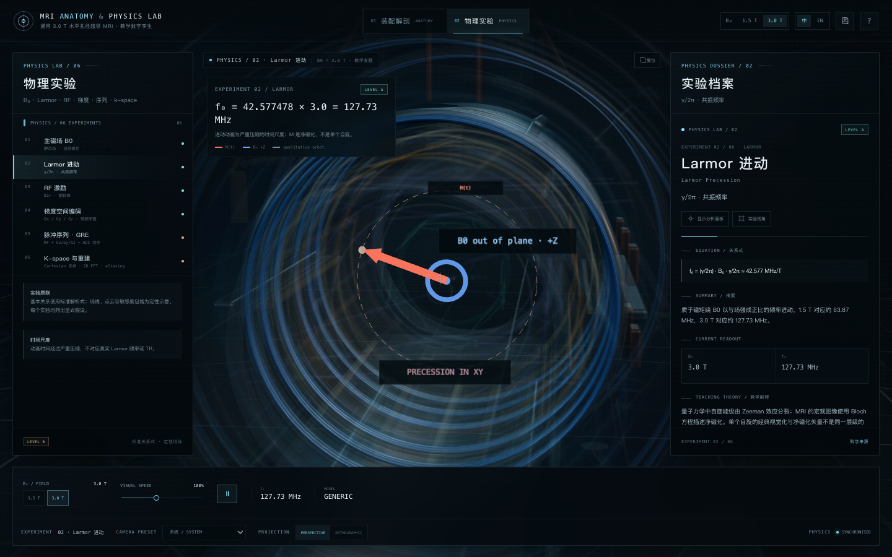
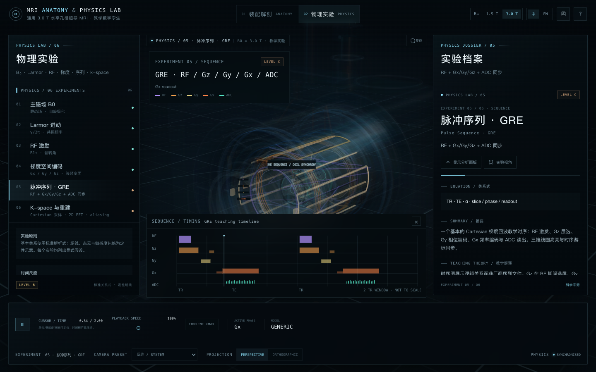
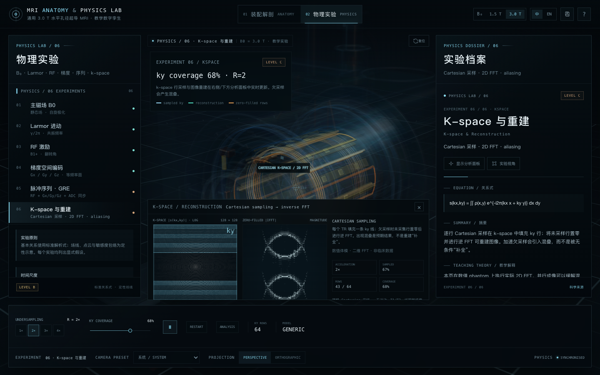
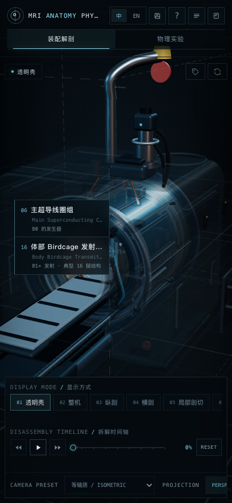

<p align="center">
  
</p>

<h1 align="center">MRI Anatomy &amp; Physics Lab</h1>

<p align="center">
  <strong>An interactive system-level teardown of a superconducting MRI — and a hands-on MRI physics laboratory.</strong><br>
  <sub>21 procedural components · 7 viewing modes · 6 physics experiments · bilingual · offline-ready</sub>
</p>

<p align="center">
  
  
  <a href="LICENSE"></a>
  
</p>

<p align="center">
  <a href="README.md">中文</a> ｜ <strong>English</strong>
</p>

<p align="center">
  <a href="https://haosen-zhang.github.io/MRI-Anatomy-Physics-Lab/">
    
  </a>
</p>

<p align="center">
  <sub><strong>Build with DeepSeek-V4.1-Flash1017.</strong> · <a href="prompt.md">open-source prompt</a></sub>
</p>

> **From the outer cover to k-space.** Explore a generic 3.0 T superconducting MRI as 21 engineering components, cut real geometry with clipping planes, isolate subsystems, and connect the hardware to the physics that forms an image.

---

## What is inside

<table>
<tr>
<td width="50%" valign="top">

### 🧩 Complete anatomy
21 components across patient interface, superconducting magnet and cryogenics, gradients, shims, RF transmit/receive and the electronics room.

Every component has its own technical dossier: structure, principle, typical materials, specifications, system relationships, imaging impact, safety notes and sources.

</td>
<td width="50%" valign="top">

### 🔬 Real sections & interactions
Longitudinal and transverse sections use **actual Three.js clipping planes**, paired with clearly marked schematic section caps and a layer legend.

Seven viewing states, staged disassembly, subsystem explode, isolate/hide, 3D callouts, focus, camera presets and perspective/orthographic cameras.

</td>
</tr>
<tr>
<td width="50%" valign="top">

### ⚡ Six MRI experiments
B₀, Larmor precession, ideal RF excitation, spatial gradient encoding, GRE timing and Cartesian k-space reconstruction.

Each experiment includes 3D overlays, live readouts, controls, teaching assumptions and sources.

</td>
<td width="50%" valign="top">

### 🎓 Built for learning
Chinese / English UI, Level A/B/C confidence labels, in-page glossary, safety boundaries and an explicit distinction between documented physics, typical engineering and schematic teaching aids.

No vendor CAD, patient data, pre-rendered video or external 3D assets.

</td>
</tr>
</table>

---

## Gallery

<p align="center">
  
</p>
<p align="center"><sub>Transparent-shell view · assembly tree · technical dossier · 3D callouts · disassembly timeline</sub></p>

<p align="center">
  <a href="previews/03-complete.png"></a>
</p>
<p align="center"><sub><strong>Complete assembly:</strong> outer housing, 70 cm bore, patient table, cold head and service turret.</sub></p>

<table>
<tr>
<td width="50%" align="center">
  <a href="previews/04-transverse.png"></a><br>
  <sub><strong>Transverse section · z = 0</strong><br>real clipping + layer caps</sub>
</td>
<td width="50%" align="center">
  <a href="previews/05-exploded.png"></a><br>
  <sub><strong>100% exploded</strong><br>component callouts</sub>
</td>
</tr>
<tr>
<td width="50%" align="center">
  <a href="previews/06-larmor.png"></a><br>
  <sub><strong>Larmor precession</strong><br>B₀ out-of-plane + M(t)</sub>
</td>
<td width="50%" align="center">
  <a href="previews/07-sequence.png"></a><br>
  <sub><strong>GRE sequence</strong><br>RF / gradients / ADC</sub>
</td>
</tr>
<tr>
<td colspan="2" align="center">
  <a href="previews/02-kspace.png"></a><br>
  <sub><strong>K-space &amp; reconstruction</strong><br>real 2D FFT + aliasing</sub>
</td>
</tr>
</table>

<h3>📱 Fully usable on mobile</h3>
<p>The assembly tree, technical dossier and experiment controls become drawers and a horizontally scrollable control deck. You can still orbit, zoom, select components, change sections and run experiments by touch.</p>
<p>A low-performance pixel-ratio mode is included for classroom projectors and phones.</p>

<p align="center">
  <a href="previews/08-mobile.png"></a>
</p>
<p align="center"><sub><strong>390 × 844</strong> · drawers / adaptive console / touch controls</sub></p>

---

## Quick start

**[Open the live demo → MRI Anatomy & Physics Lab](https://haosen-zhang.github.io/MRI-Anatomy-Physics-Lab/)**

The site is deployed with GitHub Pages. It also works offline; the repository includes a prebuilt bundle. To view locally:

```bash
git clone https://github.com/Haosen-Zhang/MRI-Anatomy-Physics-Lab.git
cd MRI-Anatomy-Physics-Lab
open index.html
```

No install or server is required. To run with a local server:

```bash
npm install
npm run dev        # http://localhost:4174
```

To rebuild after editing:

```bash
npm install
npm run build
```

The esbuild step bundles Three.js and the native ES modules into a classic IIFE that also works from <code>file://</code>.

---

## Experiment summary

| # | Experiment | What changes | What it teaches |
| :---: | :--- | :--- | :--- |
| 01 | **B₀** | 1.5 T / 3.0 T | Static field, spin polarisation; B₀ does not encode position |
| 02 | **Larmor** | Field, visual speed, play/pause | f₀ = (γ/2π)B₀; 1.5 T ≈ 63.87 MHz, 3.0 T ≈ 127.73 MHz |
| 03 | **RF excitation** | B₁, pulse duration, 90°/180°, receive channels | α = γB₁τ; rotating frame; B₁⁺ vs B₁⁻ |
| 04 | **Gradients** | Axis, amplitude, polarity | Bz ≈ B₀ + G·r; isofrequency planes |
| 05 | **GRE sequence** | Play/pause/scrub/speed | RF, Gz, Gy, Gx and ADC synchrony |
| 06 | **K-space** | Acceleration, ky coverage | Cartesian sampling, zero-filling, inverse FFT, aliasing |

The receive-array sub-mode exposes all eight head-coil channels with independent loop highlights and a qualitative sensitivity envelope.

---

## Scientific boundaries

- Basic relations (Larmor, gradient encoding, flip angle, 2D FFT) use standard analytic expressions and are marked **Level A**.
- Hardware layout is a generic teaching reconstruction, not vendor CAD or manufacturing dimensions; internal layout belongs to **Level B / C**.
- Field lines, point clouds, isofrequency planes, receive envelopes and section caps are qualitative teaching aids — **not** a Maxwell/FEM solve.
- SAR, PNS, implant heating, acoustic pressure, quench dynamics and real coil fields are not implemented.
- The architecture is a generic **low-helium, cryocooler-recondensing** system. The quench vent is an emergency path, not continuous normal-operation venting.
- Not for clinical use, scan planning, device selection or MR safety decisions.

See the in-app **Sources**, **Confidence** and **Safety** panels for the detailed notes.

---

## Project structure

```text
.
├── index.html
├── styles.css
├── js/
│   ├── main.js
│   ├── scene.js
│   ├── explosion.js
│   ├── ui.js
│   ├── physics.js
│   ├── componentsData.js
│   ├── materials.js
│   ├── geometryUtils.js
│   ├── hardware.js
│   ├── app.bundle.js
│   └── systems/
├── previews/
├── prompt.md
├── LICENSE
└── THIRD_PARTY_NOTICES.md
```

## Build & Prompt

**Build with DeepSeek-V4.1-Flash1017.**

The complete original development prompt is open-sourced in [prompt.md](prompt.md). It documents the scientific frame, hardware scope, interaction model, technical constraints and acceptance criteria. The prompt is released with this repository under the **MIT License**.

---

## License

Original code, procedural geometry, UI, text, preview renders and [prompt.md](prompt.md) are released under the **MIT License** (see [LICENSE](LICENSE)). Three.js is also MIT-licensed; its full notice is included in [THIRD_PARTY_NOTICES.md](THIRD_PARTY_NOTICES.md). External references remain the property of their respective authors.

<p align="center">
  <sub>Made with Three.js · Built for learning, not for clinical use.</sub><br>
  <sub>If this helps you understand MRI, consider starring the repository ⭐</sub>
</p>
