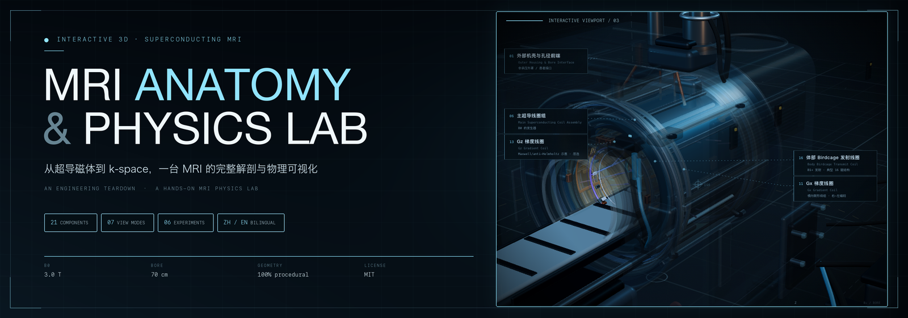
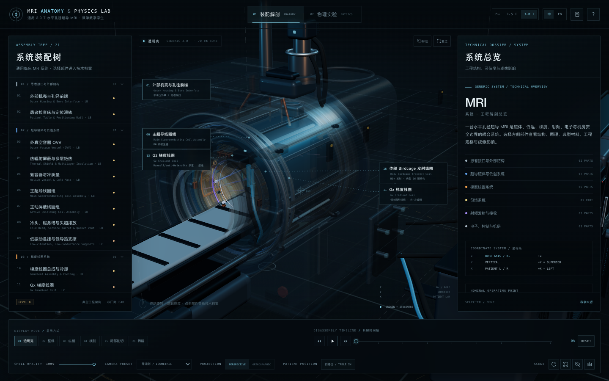
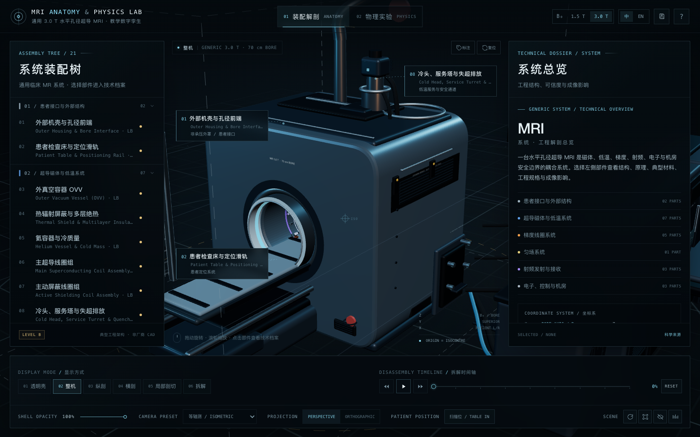
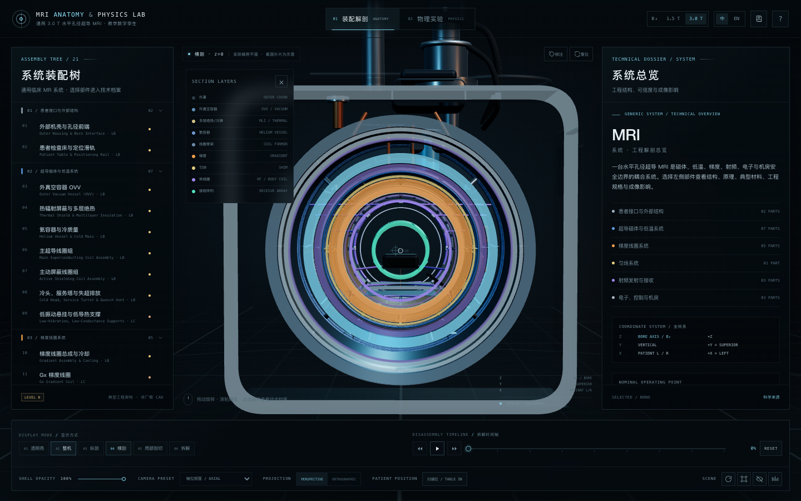
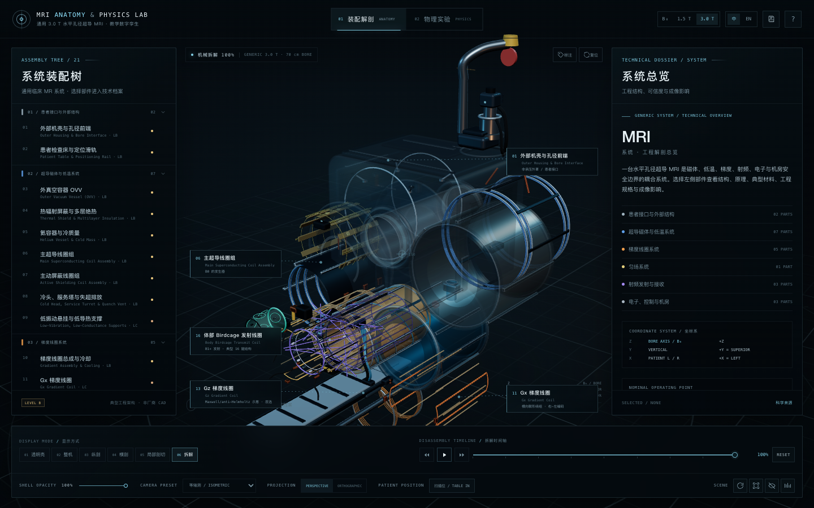
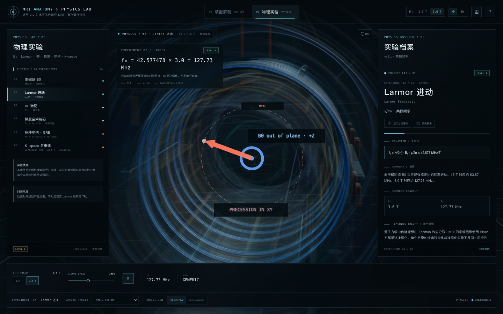
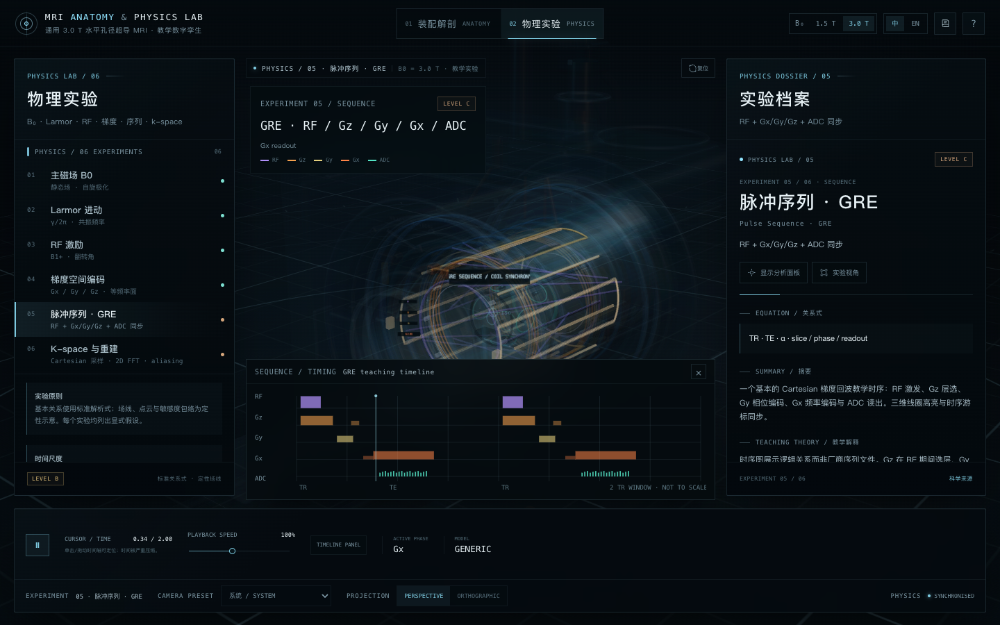
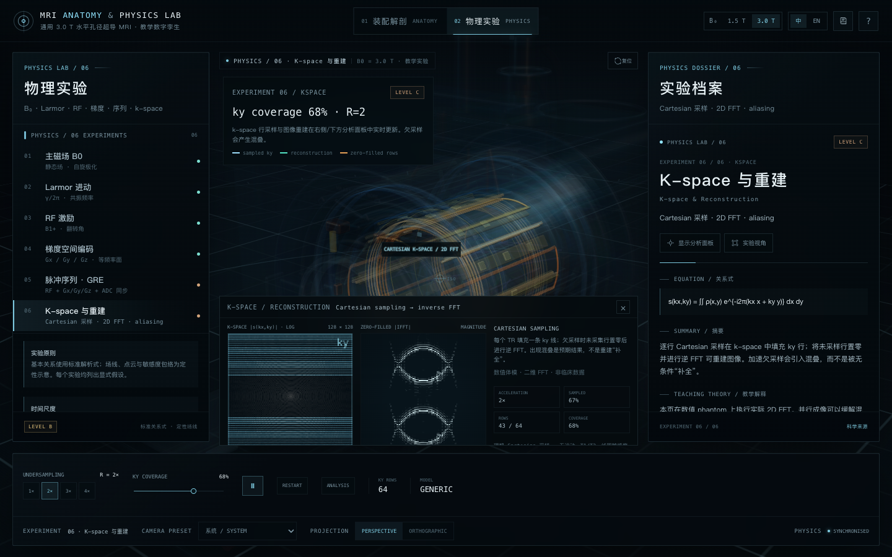
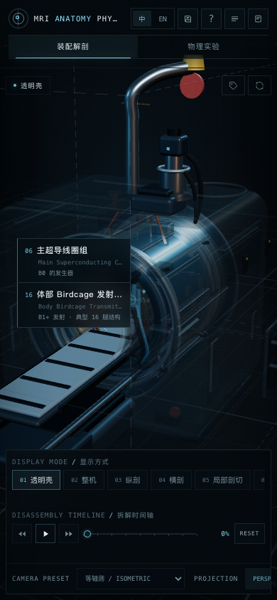

<p align="center">
  
</p>

<h1 align="center">MRI Anatomy &amp; Physics Lab</h1>

<p align="center">
  <strong>一台 MRI 的完整系统解剖 × 可交互的磁共振物理实验室</strong><br>
  <sub>Interactive 3D teardown of a superconducting MRI · an explorable MRI physics laboratory</sub>
</p>

<p align="center">
  
  
  
  <a href="LICENSE"></a>
  
</p>

<p align="center">
  <strong>中文</strong> ｜ <a href="README.en.md">English</a>
</p>

<p align="center">
  <a href="https://haosen-zhang.github.io/MRI-Anatomy-Physics-Lab/">
    
  </a>
</p>

<p align="center">
  <code>21</code> 个部件 · <code>06</code> 个子系统 · <code>07</code> 种观察模式 · <code>06</code> 个物理实验 · <code>02</code> 种语言 · <code>00</code> 个服务器依赖
</p>

> **从机壳到 k-space。** 把一台通用 3.0 T 超导 MRI 拆成可旋转、可剖切、可隔离的 21 个工程模块，再用 3D 场、脉冲时序和真实 2D FFT 把成像物理跑给你看。
>
> 全部几何均由 Three.js 在运行时程序化生成。没有外部 MRI 模型、没有厂商 CAD、没有预渲染视频。

---

## ✨ 为什么值得玩

<table>
<tr>
<td width="50%" valign="top">

### 🧩 系统级解剖
从外部机壳、患者床，到 OVV、冷屏/MLI、氦容器、NbTi 主线圈、主动屏蔽、梯度、匀场、体线圈、RF 屏蔽、8 通道头阵列、电子机柜与机房。

每个部件都有独立的 **结构 / 原理 / 典型材料 / 规格 / 系统关系 / 成像影响 / 安全 / 来源** 档案。

</td>
<td width="50%" valign="top">

### 🔬 真正的裁剪剖面
纵剖与横剖不是简单地把材质变透明，而是使用 **Three.js clipping planes** 实际裁掉几何；截面再配合明确标注为示意的彩色补片与图例。

还提供透明壳、局部剖切、整机、拆解、隔离等共 7 种观察状态。

</td>
</tr>
<tr>
<td width="50%" valign="top">

### 🎛️ 可操作的工程模型
0–100% 分阶段拆解、正放/倒放/暂停、拖动时间轴、整套或按子系统展开。

3D 拾取、Orbit、Focus、Isolate、Hide/Show、部件标签、相机预设、透视/正交切换、患者床进出、低性能模式。

</td>
<td width="50%" valign="top">

### ⚡ 六个 MRI 物理实验
B₀、Larmor 进动、RF 激发与翻转角、梯度编码、GRE 时序、Cartesian k-space + 逆 FFT。

每个实验都配有 3D 叠加、参数控制、实时读数、公式、教学解释与明确假设。射频接收阵列支持 8 个独立通道。

</td>
</tr>
</table>

---

## 🖼️ 界面一览

<p align="center">
  
</p>

<p align="center"><sub><strong>桌面端：</strong>透明壳视图 / 21 部件装配树 / 技术档案 / 3D 引线标注 / 拆解时间轴</sub></p>

<p align="center">
  <a href="previews/03-complete.png"></a>
</p>
<p align="center"><sub><strong>整机模式：</strong>外部机壳 / 70 cm 孔径 / 患者床 / 冷头与服务塔 · 先建立系统整体感，再进入内部解剖</sub></p>

<table>
<tr>
<td width="50%" align="center">
  <a href="previews/04-transverse.png"></a>
  <br><sub><strong>横剖 · z = 0</strong><br>真实裁剪 + 分层截面图例</sub>
</td>
<td width="50%" align="center">
  <a href="previews/05-exploded.png"></a>
  <br><sub><strong>100% 拆解</strong><br>按顺序展开 + 3D 部件标注</sub>
</td>
</tr>
<tr>
<td width="50%" align="center">
  <a href="previews/06-larmor.png"></a>
  <br><sub><strong>Larmor 进动</strong><br>B₀ 出平面标记 + M(t) 旋转矢量</sub>
</td>
<td width="50%" align="center">
  <a href="previews/07-sequence.png"></a>
  <br><sub><strong>GRE 脉冲序列</strong><br>RF / Gz / Gy / Gx / ADC + 3D 线圈同步高亮</sub>
</td>
</tr>
<tr>
<td colspan="2" align="center">
  <a href="previews/02-kspace.png"></a>
  <br><sub><strong>K-space 与重建</strong><br>真实 2D FFT + 欠采样混叠演示</sub>
</td>
</tr>
</table>

<table>
<tr>
<td width="56%" valign="middle">
  <h3>📱 移动端也能完整操作</h3>
  <p>桌面端的装配树、技术档案与实验控制会被收纳为抽屉和横向控制台；触屏上仍可旋转、缩放、选择部件、切换剖面和运行物理实验。</p>
  <p>页面同时提供低性能像素比模式，适合在教学演示电脑或移动设备上快速打开。</p>
</td>
<td width="44%" align="center">
  <a href="previews/08-mobile.png"></a>
  <br><sub><strong>390 × 844</strong><br>响应式实验室界面</sub>
</td>
</tr>
</table>

---

## 🧠 解剖覆盖：21 个部件

| 子系统 | 覆盖部件 | 工程重点 |
| :--- | :--- | :--- |
| **患者接口与外部结构** | 外部机壳与孔径前端、患者检查床与滑轨 | 非承压外罩、70 cm 孔径、非铁磁患者接口、床面 Z 轴进出 |
| **超导磁体与低温** | OVV、冷屏与 MLI、氦容器、主超导线圈、主动屏蔽线圈、低振动悬挂、冷头/服务塔/失超排放 | 4 K 冷质量、真空绝热、NbTi 持续电流、低氦量冷头再冷凝、失超路径 |
| **梯度系统** | 梯度线圈总成与冷却、Gx / Gy / Gz 线圈、主动屏蔽与功放接口 | 非超导铜导体、水冷/树脂支撑、梯度线性度、涡流与 PNS 边界 |
| **匀场系统** | 被动与主动匀场 | ppm 级 B₀ 均匀度、无源铁片/有源线圈的教学分工 |
| **射频发射与接收** | 体 Birdcage 发射线圈、RF 屏蔽层、8 通道头接收阵列 | B₁⁺ 发射、B₁⁻ 接收、鸟笼结构、接收阵列空间敏感度 |
| **电子、控制与机房** | 功放/谱仪机柜、重建工作站、RF 屏蔽机房 | 梯度/RF 链路、重建、Faraday cage、波导与机房边界 |

> 每个部件都带有 **Level A / B / C** 可信度标签。基本物理关系为 Level A；典型工程架构为 Level B；教学示意与补片为 Level C。

---

## ⚡ 物理实验：从自旋到图像

| # | 实验 | 你可以操作什么 | 你会理解什么 |
| :---: | :--- | :--- | :--- |
| 01 | **B₀ 主磁场** | 1.5 T / 3.0 T 场强切换 | 静态场、自旋极化、B₀ 本身不进行空间编码 |
| 02 | **Larmor 进动** | 场强、视觉速度、播放/暂停 | f₀ = (γ/2π)B₀，1.5 T ≈ 63.87 MHz，3.0 T ≈ 127.73 MHz |
| 03 | **RF 激发** | B₁ 幅度、脉冲持续时间、90°/180° 预设、接收阵列通道 | α = γB₁τ，旋转坐标系，B₁⁺ 与 B₁⁻ 的区别 |
| 04 | **梯度空间编码** | Gx / Gy / Gz、幅度、极性 | Bz ≈ B₀ + G·r，等频率面与频率编码 |
| 05 | **GRE 脉冲序列** | 播放、暂停、拖动时间轴、改变速度 | RF / 选层 / 相位编码 / 读出 / ADC 的同步关系 |
| 06 | **K-space 重建** | 加速倍数 R、ky 覆盖、采样播放 | Cartesian 行采样、零填充、真实 2D FFT、欠采样混叠 |

这六个实验共用同一个 3D 解剖场景：时序游标会驱动线圈高亮；改变场强会更新频率、读数和相对进动速度；RF 接收模式会逐通道点亮头线圈。

---

## 🚀 快速开始

### 在线体验

**[打开 Live Demo → MRI Anatomy & Physics Lab](https://haosen-zhang.github.io/MRI-Anatomy-Physics-Lab/)**

部署在 GitHub Pages，直接打开即可浏览。若需要离线使用，也可以按下面的方式本地打开。

### 直接打开（推荐）

项目已包含离线打包产物，**不需要安装依赖或启动服务器**：

```bash
git clone https://github.com/Haosen-Zhang/MRI-Anatomy-Physics-Lab.git
cd MRI-Anatomy-Physics-Lab
open index.html        # macOS；Windows/Linux 直接双击 index.html
```

如果想用本地 HTTP 服务器：

```bash
npm install
npm run dev            # http://localhost:4174
```

### 修改后重新打包

```bash
npm install
npm run build          # 生成 js/app.bundle.js
```

构建使用 esbuild，把 Three.js 和所有 ES Module 源码打包为可直接从 <code>file://</code> 打开的经典 IIFE。

---

## 🕹️ 操作手册

| 操作 | 效果 |
| :--- | :--- |
| 拖动 / 滚轮 / 双指 | 旋转、缩放 3D 场景 |
| 点击实体部件 | 打开右侧技术档案；再点空白处取消 |
| 左侧分类 | 折叠/展开；眼睛图标控制可见性 |
| 档案操作 | Focus / Isolate / Hide / **Explode system** / Clear |
| 底部模式 | 透明壳 / 整机 / 纵剖 / 横剖 / 局部剖切 / 拆解 |
| 拆解时间轴 | 正向播放、反向播放、暂停、0–100% 拖动定位 |
| 相机预设 | Isometric / Front / Rear / Left / Right / Top / Axial / Longitudinal / Systems |
| 底部工具 | Shell opacity、投影切换、患者床进出、标注、自动旋转、低性能 |
| 快捷键 | <code>Space</code> 播放/暂停；<code>Esc</code> 关闭弹窗/抽屉 |

### 推荐学习路径

1. **整机 / 透明壳**：先建立系统空间感。
2. 点击 **超导磁体 → OVV / 冷屏 / 氦容器 / 主线圈**：理解 B₀ 与低温边界。
3. 切到 **横剖 / 纵剖**：观察同轴层级、梯度、RF 和患者孔径。
4. 选择一个梯度或 RF 部件，点击 **Explode system**：查看子系统装配关系。
5. 进入 **物理实验 → Larmor / RF / Gradient / Sequence / K-space**：把硬件与物理量对应起来。
6. 打开 **Sources / Safety / Confidence**：区分文献关系、典型工程和教学示意。

---

## 🧪 科学态度与边界

- **基础关系**（Larmor、梯度编码、翻转角、2D FFT）使用标准解析式；对应的实验标记为 **Level A**。
- **硬件架构**是通用教学重建，不是任何厂商产品、CAD 图纸或制造尺寸；具体轴向位置、绕组数量和层间包络属于 **Level B / C**。
- 场线、点云、等频率面、接收敏感度包络和截面补片全部是 **定性/示意**，不是 Maxwell/FEM 数值解。
- 未实现 SAR、PNS、植入物加热、声压、失超动力学或真实线圈电磁场。
- 本模型采用 **低氦量、冷头再冷凝** 架构；正常扫描不通过失超管道持续排放氦气，失超管只作为紧急排放路径。
- 不用于扫描规划、设备选型、临床诊断或 MR 安全决策。

> **通用教学模型。不是医疗器械，也不代表任何厂商产品。**

---

## 🏗️ 技术栈

| 层 | 实现 |
| :--- | :--- |
| 3D | Three.js r187、WebGL 2、PBR 材质、程序化几何、生成式环境贴图 |
| 剖面 | 真实 local clipping planes + 程序化示意截面补片 |
| 物理 | 解析关系、3D 矢量/场叠加、Canvas 时序图、真实 2D FFT 重建 |
| UI | 原生 HTML/CSS/JavaScript、Canvas、响应式抽屉布局 |
| 打包 | esbuild → 经典 IIFE，离线可用 |
| 内容 | 21 个部件档案、6 个实验、6 个来源、Level A/B/C、术语与安全说明 |

所有几何、材质、标注和数值体模均在浏览器中生成；仓库不包含 MRI 厂商 CAD、真实患者数据或外部 3D 资产。

---

## 📁 项目结构

```text
.
├── index.html                  # 页面外壳、HUD、控制台
├── styles.css                  # 深色科学仪器风格 / 响应式
├── js/
│   ├── main.js                 # 应用编排、拾取、相机、UI 事件
│   ├── scene.js                # 渲染器、部件注册、相机、剖面
│   ├── explosion.js            # 显示模式、拆解、隔离、材质状态
│   ├── ui.js                   # 装配树、技术档案、弹窗、3D 标注
│   ├── physics.js              # 六个实验、时序 Canvas、k-space FFT
│   ├── componentsData.js       # 21 个部件与科学内容模型
│   ├── materials.js            # PBR 材质与生成式环境
│   ├── geometryUtils.js        # 程序化几何工具
│   ├── hardware.js             # 硬件装配入口
│   ├── app.bundle.js           # 预构建离线 bundle
│   └── systems/                # 机壳、磁体、梯度、RF、机房
├── previews/                   # README 与教学预览图
├── LICENSE
└── THIRD_PARTY_NOTICES.md
```

---

## 🔗 来源与扩展

页面内的 **Sources** 与 **Safety** 弹窗提供文献链接、应用边界和术语表。主要公开参考包括：

- ISMRM — *MRI: A Systems Overview*
- P. E. Z. Larson — *Principles of MRI: The MRI System*
- NIH / NIBIB — *Magnetic Resonance Imaging (MRI)*
- Canon Medical Systems — *MRI Scanners: Technology*
- RSNA RadioGraphics — *Clinical MRI RF Coils: A Practical Guide*
- NIST / CODATA — *Proton gyromagnetic ratio and fundamental constants*

更完整的模型说明和实验假设直接写进了每个部件与每个实验中，而不是隐藏在一个“免责声明”里。

---

## 📜 License

- 本项目原创建模、界面、文字与预览图：**MIT License**，见 [LICENSE](LICENSE)。
- 运行时包含 **Three.js r187**（MIT）；其版权与许可证全文见 [THIRD_PARTY_NOTICES.md](THIRD_PARTY_NOTICES.md)。
- 外部文献仅作为引用与延伸阅读，其版权归原作者/机构所有。

---

<p align="center">
  <sub>Made with Three.js · Built for learning, not for clinical use.</sub><br>
  <sub>如果这个项目让你更理解 MRI，欢迎 ⭐ Star / 分享给需要的人。</sub>
</p>
